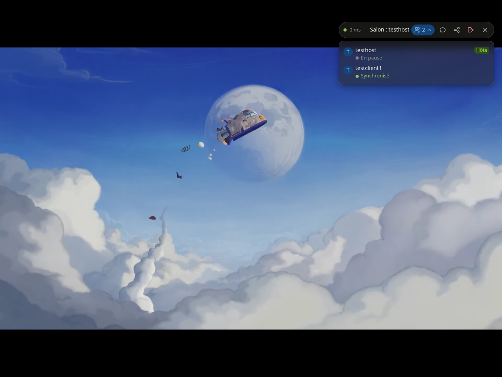

<p align="center">
  
</p>

# OpenWatchParty Documentation

OpenWatchParty is a Jellyfin plugin that enables synchronized media playback across multiple clients. Watch movies and shows together with friends, no matter where they are.

Version 0.7 includes room chat, shared playback controls, episode queues with an up-next countdown, expiring invite links, and host recovery and transfer. See the [feature guide]({{ '/product/features/' | relative_url }}) for details.

<p align="center">
  
</p>

## Quick Start

### For Users

Deploy the session server and install the plugin.
Follow the [illustrated first watch-party tutorial]({{ '/product/first-watch-party/' | relative_url }}) for installation, screenshots and a two-person walkthrough. The [Installation Guide]({{ '/operations/installation/' | relative_url }}) covers manual alternatives.

### For Developers

Set up a development environment:

```bash
git clone https://github.com/mhbxyz/OpenWatchParty.git
cd OpenWatchParty
just setup   # Install client dependencies and configure Git hooks
just up      # Build and start Jellyfin + session server
just dev     # Start with log following
just watch   # Auto-restart on file changes
```

The dev stack binds to loopback and defaults to unauthenticated local development when `JWT_SECRET` is empty. Production Compose requires JWT authentication. See [Development Setup]({{ '/development/setup/' | relative_url }}) for the full workflow and [First Watch Party]({{ '/product/first-watch-party/' | relative_url }}#host-create-a-room) for the illustrated host/guest steps.

---

## Documentation

| Getting Started | Operations | Technical |
|-----------------|------------|-----------|
| [First Watch Party]({{ '/product/first-watch-party/' | relative_url }}) | [Installation]({{ '/operations/installation/' | relative_url }}) | [Architecture]({{ '/technical/architecture/' | relative_url }}) |
| [Overview]({{ '/product/overview/' | relative_url }}) | [Guided Setup]({{ '/operations/owpctl/' | relative_url }}) | [Protocol]({{ '/technical/protocol/' | relative_url }}) |
| [Features]({{ '/product/features/' | relative_url }}) | [Configuration]({{ '/operations/configuration/' | relative_url }}) | [Server]({{ '/technical/server/' | relative_url }}) |
| [User Guide]({{ '/product/user-guide/' | relative_url }}) | [Deployment]({{ '/operations/deployment/' | relative_url }}) | [Client]({{ '/technical/client/' | relative_url }}) |
| [FAQ]({{ '/product/faq/' | relative_url }}) | [Compatibility]({{ '/operations/compatibility/' | relative_url }}) | [Plugin]({{ '/technical/plugin/' | relative_url }}) |
| | [Security]({{ '/operations/security/' | relative_url }}) | [Sync Algorithms]({{ '/technical/sync/' | relative_url }}) |
| | [Troubleshooting]({{ '/operations/troubleshooting/' | relative_url }}) | [REST API]({{ '/technical/api/' | relative_url }}) |
| | [Monitoring]({{ '/operations/monitoring/' | relative_url }}) | |

## Development

- [Development Setup]({{ '/development/setup/' | relative_url }}) - Get started contributing
- [Contributing Guide]({{ '/development/contributing/' | relative_url }}) - Code style and PR process
- [Testing]({{ '/development/testing/' | relative_url }}) - Running tests
- [CI/CD]({{ '/development/ci/' | relative_url }}) - Automated workflows
- [Release Process]({{ '/development/release/' | relative_url }}) - How releases are made

## Architecture Overview

```
┌─────────────────┐     ┌─────────────────┐     ┌─────────────────┐
│  Jellyfin Web   │     │  Session Server │     │  Jellyfin Web   │
│    (Host)       │◄───►│     (Rust)      │◄───►│   (Clients)     │
└─────────────────┘     └─────────────────┘     └─────────────────┘
        │                        │                       │
        └────────────────────────┴───────────────────────┘
                         WebSocket (ws://)
```

**Components:**
- **Jellyfin Plugin (C#)** - Serves client JavaScript, provides configuration UI
- **Session Server (Rust)** - Manages rooms and relays sync messages via WebSocket
- **Web Client (JavaScript)** - Injected into Jellyfin UI, handles playback synchronization

## Glossary

Technical terms used throughout this documentation:

| Term | Full Name | Description |
|------|-----------|-------------|
| **HLS** | HTTP Live Streaming | Adaptive streaming protocol that breaks video into small segments. Used by Jellyfin for transcoded content. |
| **RTT** | Round-Trip Time | Time for a message to travel from client to server and back. Displayed in the room bar as latency. |
| **EMA** | Exponential Moving Average | Smoothing algorithm used for clock synchronization. Prevents sudden jumps in time offset. |
| **JWT** | JSON Web Token | Compact, URL-safe token format for authentication. Contains user identity claims signed with a secret key. |
| **CORS** | Cross-Origin Resource Sharing | Browser security mechanism controlling which websites can connect to the session server. |
| **WebSocket** | - | Full-duplex communication protocol over a single TCP connection. Used for real-time sync. |
| **Drift** | - | Difference between expected and actual playback position. Corrected by adjusting playback rate. |
| **Host** | - | The user who created the watch party room. Has exclusive control over playback. |
